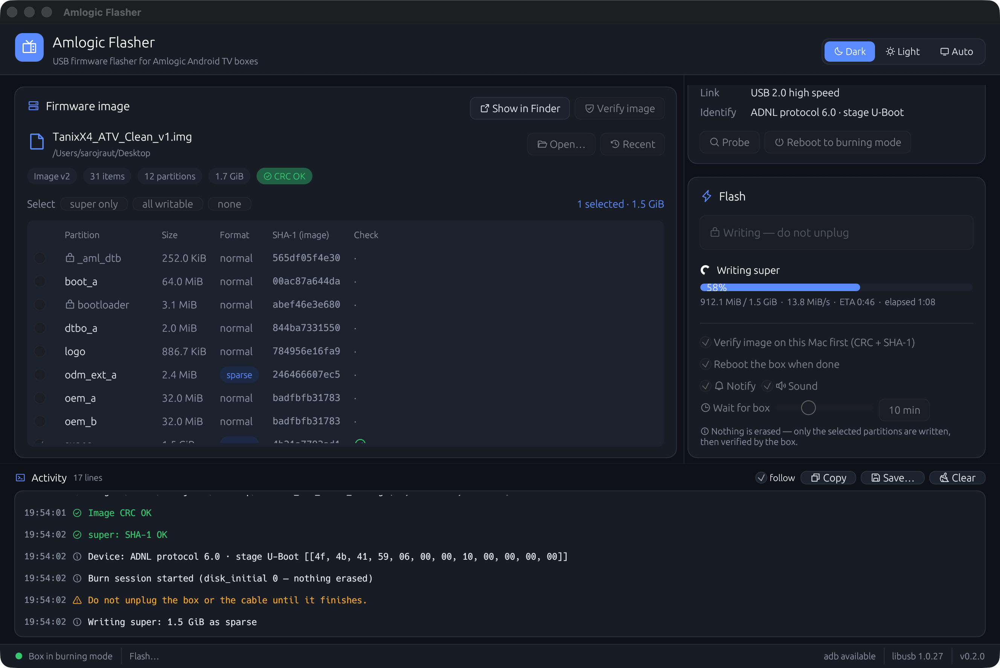
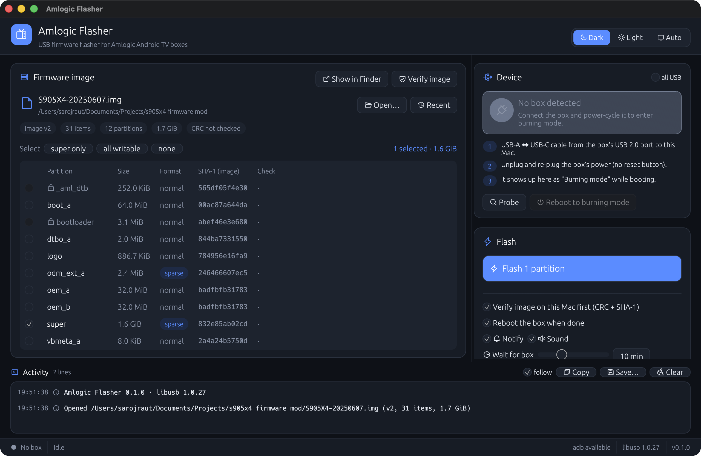
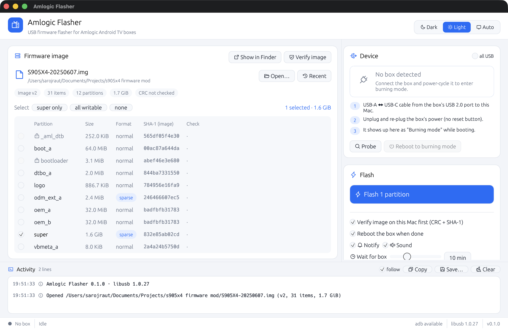

# Amlogic-Flash

A native macOS app (Rust) that flashes Amlogic Android TV boxes over USB, with no Windows PC, no USB Burning Tool and no drivers.



*Flashing `super` on a real Tanix X4: 13.8 MiB/s over USB 2.0, checked on the Mac before writing and verified by the box after.*

<details><summary>Idle screens: dark and light</summary>




</details>

It speaks Amlogic's **ADNL** burning protocol to the box's own U-Boot, the same protocol as the vendor's USB Burning Tool. It writes **only the partitions you select** from a standard `aml_upgrade_package` `.img` file.

Tested on a **Tanix X4 (S905X4 / SC2, Android 11)**, flashing a modified `super` partition (1.5 GiB in about 2.5 minutes). It should work on other Android 11+ Amlogic boxes whose U-Boot answers ADNL (protocol 5 or 6), but only the Tanix X4 has been tested.

## Why

On many Android 11+ Amlogic boxes the usual Mac routes are blocked:

| Route | Typical result |
|---|---|
| `fastboot flash super` (boot loader) | `FAILED (remote: '0ffff110')`, because dynamic partitions are meant for fastbootd |
| fastbootd (recovery) | The box's USB port runs in host mode under Linux, so it never appears on the Mac |
| SD burn card + reset button | The reset button cycles fastboot → update → recovery and never runs `sdc_burn` |
| **ADNL (this app)** | ✅ U-Boot runs `adnl` on every cold boot (`try_auto_burn`) |

## Features

- Opens Amlogic burn images (v1 and v2) and lists every partition with its size, format (normal/sparse) and SHA-1.
- **Pre-flight checks on the Mac**: header CRC, the SHA-1 of each selected partition against its `VERIFY` entry, and the Android sparse magic. A corrupt or wrongly repacked image is refused before USB is touched.
- Sends sparse partitions (`super`, `odm_ext`) as **sparse**. Writing them as `normal` would corrupt the partition.
- **Nothing is erased** (`disk_initial 0`). Only the selected partitions are written.
- The **box verifies** each partition (SHA-1) after writing, and the app reboots it only if that passes.
- `bootloader` and `_aml_dtb` are **protected**: they need a full ROM-stage burn, and a mistake there can hard-brick a box.
- **Landscape UI** with light, dark and auto (follows macOS) themes, remembered between launches.
- **Smart USB detection**: recognises the box in each mode it can be in (burning mode (ADNL), old Optimus burning mode, fastboot, adb) and tells you what to do next. It logs plug and unplug events with bus, port and link speed.
- **Reboot to burning mode** button (`adb reboot update`) when the box is running Android with USB debugging on.
- **Verify image** button: checks the CRC and every partition's SHA-1, with ✓ / ✗ per partition.
- Quick partition selection (super only / all writable / none), recent images, drag and drop, ⌘O.
- Progress with transfer speed and ETA, a macOS notification and sound when done, a configurable wait time.
- Activity log with timestamps and levels; copy, save or clear it.
- libusb is linked statically, so the app needs no Homebrew or drivers.
- A CLI for scripting.

## Install

Download the `.dmg` from Releases, or build it yourself:

```bash
brew install rust            # or use rustup
./scripts/bundle-macos.sh    # creates dist/Amlogic Flasher.app and dist/Amlogic-Flasher-<ver>.dmg
```

The app is ad-hoc signed. On first launch, right-click it and choose **Open** (or allow it in System Settings → Privacy & Security).

## How to flash

1. Connect a **USB-A ↔ USB-C** cable from the box's USB port (usually the USB 2.0 / OTG one) to the Mac.
2. Open the `.img` (drag and drop works), check the partitions to write (default: `super`), and press **⚡ Flash**.
3. **Unplug and re-plug the box's power.** Don't press the reset button. The box listens for about one second while booting, and the app catches it.
4. Wait for "verified on device ✓". The box reboots by itself.
5. After writing `super`, if Android shows *"Can't load Android system"*, choose **Factory data reset** in recovery.

Use **Probe box** first to confirm the connection without writing anything.

> ⚠️ Only flash images built for your exact box model. Keep the stock firmware: flashing its `super` the same way restores the box.

## CLI

```bash
amlogic-flash info  firmware.img                   # list items, check CRC and every partition's SHA-1
amlogic-flash devices [--all]                      # list Amlogic / fastboot / adb USB devices
amlogic-flash probe                                # wait for a box in burning mode and identify it
amlogic-flash flash firmware.img --part super      # write partitions (repeat --part), then reboot
           [--no-reboot] [--skip-check]
```

## Protocol summary

```
getvar:identify                         -> OKAY + [proto(5|6), minor, ?, stage(0x10 = U-Boot)]
oem setvar burnsteps 0xc0041030 / …31
oem disk_initial 0                      (0 = do not erase)
oem setvar burnsteps 0xc0041032
oem mwrite 0x<size> <normal|sparse> store <partition>
  loop: mwrite:verify=addsum -> DATAOUT0x<len>:0x<offset>
        <len bytes>, then a 4-byte LE additive checksum -> OKAY
  until the reply is OKAY
oem verify sha1sum <hex>                -> INFO … OKAY
reboot
```

## Credits

The protocol details come from [pyamlboot](https://github.com/superna9999/pyamlboot) (GPL-2.0 OR MIT, used here under MIT) and from reading the device's U-Boot. Amlogic and the Amlogic burning tools are trademarks and software of Amlogic, Inc. This project is not affiliated with Amlogic.

## License

MIT. Use at your own risk: flashing firmware can brick devices.
